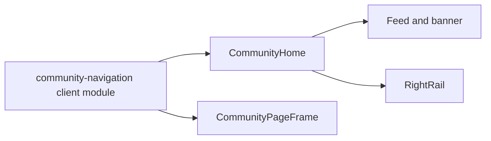

# 18 · 前端社区导航抽取：共享壳层保持一个职责清楚的模块

> 实现提交：`f54ccf7`（`codex/community-navigation`）

## 一、架构迁移全景

首页模块同时承载内容流、右栏和共享导航。此次把频道侧栏、游戏标识、顶栏、active route 判断和移动抽屉焦点管理迁入 `community-navigation.tsx`。首页与 `CommunityPageFrame` 都从同一模块消费这些入口；Feed 和 RightRail 留在首页模块。

这是模块搬迁，不改变交互契约。路径、query active 状态、搜索提交、抽屉键盘行为及视觉都沿用原实现。

## 二、关键难点解析

导航不只被首页使用：`CommunityPageFrame` 也是调用方。只搬 JSX 而遗漏这个调用方，会让首页工作、子页面却继续依赖旧模块。改动前搜索了全仓导入和所有消费点，并用现有 shell 与 UI 回归测试覆盖两种页面入口。

导航模块依赖路由 hooks、事件处理和焦点管理，所以它仍是客户端模块。RightRail 的快捷工具数据继续留在其消费模块，避免把无关右栏职责塞进导航模块。

## 三、STAR 叙事

**Situation**：社区首页模块混合内容流与跨页面共享导航，维护时需要在大文件中定位不同职责。

**Task**：抽出共享导航，且不改变首页和子页面的使用行为。

**Action**：新建导航模块，迁移侧栏、顶栏、active route 逻辑和抽屉焦点 hook；更新首页与共享页面框架导入；通过现有端到端用例验证。

**Result**：共享导航有独立模块，两类页面共用同一实现；lint、类型、格式、Vitest、定向 Playwright 和 production build 均通过。

## 四、原理详解

路由选中态仍由 `usePathname` 与 `useSearchParams` 推导。抽屉 hook 管理关闭后的焦点恢复、打开时的初始焦点、Tab 环绕和 Escape。模块迁移保留这些状态行为及其 DOM 标签。

## 五、面试问题整理

- **为什么导航需要单独模块？** 它跨首页和多个内容页复用；独立模块让共享壳层的调用关系清晰，也避免首页文件继续承担导航实现细节。
- **抽取后如何防止行为变化？** 先盘点所有导入点，再用页面级测试覆盖频道、响应式布局和键盘抽屉行为，同时跑类型检查和生产构建。
- **为什么模块保留 `use client`？** 路由 hooks、React 状态和浏览器焦点事件都要求客户端运行。

## 六、技术选型对比

| 方案 | 取舍 |
|---|---|
| 将共享导航留在首页文件 | 少改一个调用点，但页面框架仍需从首页导入导航，职责关系不清晰 |
| 抽取为客户端导航模块 | 两类消费点依赖同一个职责模块，改动范围小且不改变页面行为 |
| 顺带重写抽屉或 active route 逻辑 | 会混入行为变化，增加回归风险；本次不需要 |

## 七、面试叙事模板

**30 秒版**：我把鸣潮社区首页中跨页面复用的导航壳层抽到独立客户端模块，让首页和通用页面框架共享同一套频道、搜索和移动抽屉实现。迁移期间保留现有路由与焦点行为，并用 41 条 Playwright、39 条 Vitest、lint、TypeScript、格式检查和 production build 验证。

**2 分钟版**：社区首页模块同时负责内容流、右栏和共享导航，子页面框架也从首页导入导航，造成职责和依赖方向不直观。我先搜索所有导航消费点，确认除首页外 `CommunityPageFrame` 也在使用；然后只移动侧栏、顶栏、游戏标识、active route 判断和抽屉焦点 hook 到一个客户端模块，Feed 与 RightRail 保持原位。改动重点是保持旧行为：URL/query 选中态、搜索提交、窄视口抽屉、Escape 和焦点环绕。最后跑相关 Playwright 41/41、Vitest 39/39、lint、tsc、format check 和 Next.js production build，双轴 review 未发现问题。
