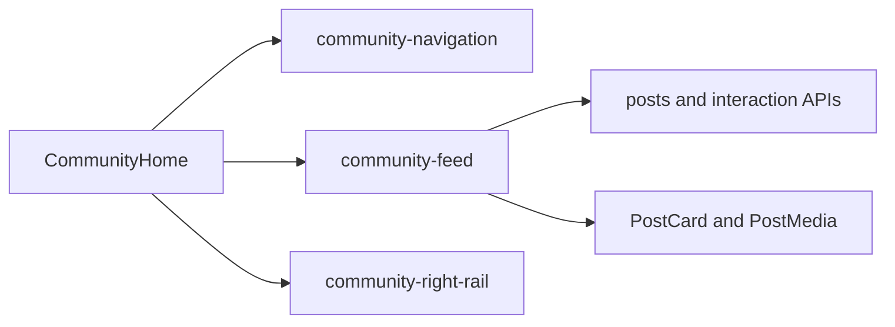

# 19 · 首页内容流抽取：将帖子渲染与数据请求收拢到 Feed 模块

> 实现提交：待提交（`codex/community-feed`）

## 一、架构迁移全景

社区首页此前同时承载导航、Banner、Feed 请求状态、互动状态批量加载、帖子卡片和右栏。导航和右栏已分别抽离后，本次将 Banner、Feed helpers、PostMedia、PostCard 和 CommunityFeed 迁入 `community-feed.tsx`。`community-home.tsx` 只组合导航、内容流和右栏。

这是模块职责迁移，没有改变请求、缓存、互动、排序、错误态或渲染行为。

## 二、关键难点解析

内容流实现有较多直接依赖：路由 query、React Query、帖子与互动 API、mutation、登录演示态、举报/关注组件以及媒体轮播。搬迁时要完整移动依赖闭包，同时避免新模块反向依赖首页。通过全仓搜索确认旧实现只有首页调用，抽取后消费点仅是 `CommunityHome`。

验证沿用现有用户路径：定向 Playwright 覆盖首页壳层、关注分页、请求数、媒体和互动写后读；全量 Playwright 检查跨域回归。

## 三、STAR 叙事

**Situation**：Feed 和帖子卡片与页面壳层共处一个大组件文件，阅读与修改时需要跨越多种职责。

**Task**：独立内容流模块，保留首页既有契约。

**Action**：迁移 Banner、Feed helpers、PostMedia、PostCard 与 CommunityFeed，首页改为组合三个职责模块；通过定向及全量验证。

**Result**：首页壳层只负责页面组合；静态检查、39 条 Vitest、100 条 Playwright 和 production build 通过，双轴 review 无发现。

## 四、原理详解

`community-feed.tsx` 保持客户端边界，因为它使用 React hooks、路由状态和交互组件。API 查询与批量互动状态仍留在 Feed 内，卡片只消费传入的互动状态，不新增请求或本地状态源。

## 五、面试问题整理

- **为什么单独抽 Feed？** 它包含独立的数据读取、状态和渲染闭环；拆分后首页入口更容易看出页面组成。
- **如何避免搬迁引入行为变化？** 保持实现原样迁移，先核对所有消费点，再运行 Feed 相关 Playwright、全量 E2E、静态检查和构建。
- **为什么 Feed 模块仍是客户端组件？** 它依赖 hooks、路由 query 和浏览器交互。

## 六、技术选型对比

| 方案 | 取舍 |
|---|---|
| 继续把 Feed 放在首页文件 | 少文件，但首页壳层仍同时承载请求和帖子交互细节 |
| 抽为独立客户端模块 | 清晰表达页面组合边界，完整保留数据与渲染闭环 |
| 顺带改写查询和互动逻辑 | 会扩大行为变更与回归范围；本切片不需要 |

## 七、面试叙事模板

**30 秒版**：我把社区首页中的 Banner、Feed 数据状态、帖子卡片与媒体渲染迁移到独立客户端模块，让首页文件回到页面组合职责。实现保持原样，通过 54 条定向 Playwright、100 条全量 Playwright、39 条 Vitest、静态检查、生产构建和双轴 review 验证。

**2 分钟版**：社区首页经过导航和右栏抽取后，Feed 仍是最大的单块职责，混合了 API 查询、关注流游标、批量互动状态、帖子卡片菜单、举报、媒体和 Banner。我先搜索 Feed 与卡片的调用点，确认它们只由首页消费；再把 Banner、helpers、媒体、卡片和 Feed 组件整体移动到新客户端模块，首页只将原调用替换为 `CommunityFeed`。这样不改变请求数、缓存、交互状态和页面结构。验证包括相关 54 条 Playwright、全量 100 条 Playwright、Vitest 39/39、lint、TypeScript、格式检查、Next.js build，以及规格和工程标准两轴 review。
