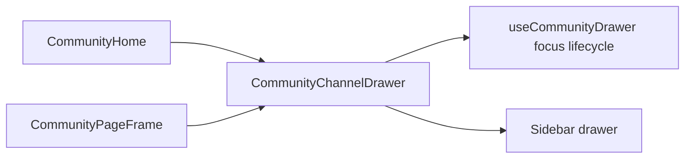

# 20 · 社区共享频道抽屉：让导航外壳共用焦点与关闭行为

> 实现提交：待提交（`codex/community-channel-drawer`）

## 一、架构迁移全景

首页与社区子页面各自渲染移动频道抽屉；焦点管理 hook 已位于共享导航模块，但 hook 的调用、遮罩、dialog、关闭按钮和 Sidebar 仍重复。本次把 hook 与抽屉结构一起封装为 `CommunityChannelDrawer`，两个页面外壳传入打开状态和 state setter。

这次只统一实现来源，保留原来的 class、ARIA、链接、遮罩关闭、Escape、Tab 限制和焦点归还行为。

## 二、关键难点解析

抽屉组件在关闭时仍需挂载。焦点 hook 依赖 `open: true → false` 的 effect 转换来把焦点还给菜单按钮；如果父组件只在打开时创建抽屉，关闭时组件立即卸载，恢复焦点的关闭分支就不会执行。共享组件因此始终参与渲染，在 `open=false` 时只返回 `null`，让 hook 保留完整生命周期。

原键盘用例只覆盖 `/guides`。测试扩展为依次检查首页和子页面，避免共享模块只在一个页面壳层接入正确。

## 三、STAR 叙事

**Situation**：首页和子页面重复实现同一移动频道抽屉，导航属性容易随页面产生漂移。

**Task**：统一抽屉实现，同时保持指针和键盘交互。

**Action**：将 dialog、遮罩关闭与焦点管理收拢到导航模块的共享组件，并用同一浏览器用例覆盖两个入口。

**Result**：两个页面壳层复用同一抽屉；静态检查、39 条 Vitest、100 条 Playwright、production build 和双轴 review 均通过。

## 四、原理详解

组件对外只接收 `open` 和 `setOpen`。hook 在打开时保存当前焦点并聚焦关闭按钮，管理 Escape 和 Tab 环绕；状态关闭后恢复焦点并清理监听器。

## 五、面试问题整理

- **为什么抽屉关闭时仍让组件挂载？** 关闭 effect 需要和打开 effect 配对执行，负责焦点归还；卸载组件不会运行 `open=false` 分支。
- **为什么两个页面都要测？** 以前有两份实现，单测一个入口不能证明另一个调用方接入正确。
- **如何保证抽取没有改变无障碍行为？** 保留 dialog 语义和焦点逻辑，并在真实浏览器中验证初始焦点、Tab、Escape 与焦点恢复。

## 六、技术选型对比

| 方案 | 取舍 |
|---|---|
| 两个页面继续各自保留抽屉 | 接入简单，但 markup 和无障碍细节会漂移 |
| 共享组件拥有抽屉和焦点生命周期 | 页面壳层只传状态；视觉与交互由单一实现维护 |
| 只共享视觉 JSX、hook 留在调用方 | 两个父组件仍需协调 ref 与生命周期，接口更复杂 |

## 七、面试叙事模板

**30 秒版**：我把首页与社区子页面重复的移动频道抽屉抽成一个共享组件，并将焦点管理生命周期封在模块内部。关键点是抽屉关闭时组件仍保持挂载，让关闭 effect 能恢复焦点。最后用真实浏览器覆盖首页与子页面的初始焦点、Tab 限制、Escape 和焦点恢复。

**2 分钟版**：社区首页和 `CommunityPageFrame` 各有一份几乎相同的移动导航抽屉，尽管焦点 hook 已经共享，dialog、关闭按钮和遮罩逻辑仍会漂移。我把 hook 与抽屉结构一起放进 navigation 模块，父页面只传 `open` 和稳定的 state setter。实现时最需要保留的是状态生命周期：打开时记录触发按钮并把焦点移入抽屉，关闭时恢复焦点；因此共享组件即使在关闭态也保持挂载，只隐藏 DOM。测试把原 `/guides` 键盘用例扩展到 `/` 与 `/guides`，再通过全量 Playwright、静态检查、Vitest、production build 和双轴 review 验证。
