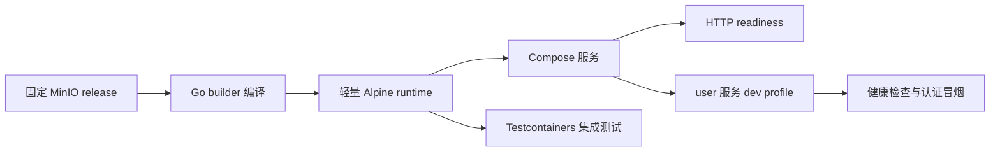

# 23 · MinIO 源码构建与 Compose 启动验收

> 提交范围：CI 中 MinIO 镜像 401 的定位、源码构建替代方案，以及全栈暴露的 user profile 缺失修复。

## 一、架构迁移全景

CI 原来从 `quay.io/minio/minio:latest` 拉取 MinIO。镜像拉取返回 401 后，部署冒烟和后端 MinIO 集成测试都无法完成。项目保留现有 MinIO、S3 API、Java SDK 和数据卷，改为在仓库的 `docker/minio/Dockerfile` 中从固定上游版本编译 MinIO。

Compose 和 Testcontainers 共用这份 Dockerfile，降低开发环境、集成测试和部署验收使用不同镜像行为的风险。镜像的 Go builder 与 Alpine runtime 都固定到多架构 digest。健康检查改为访问 MinIO 的 HTTP readiness endpoint。

构建源码镜像并让部署继续运行后，CI 又发现 `user` 服务收到开发验证码但没有 Spring profile，安全校验器按设计拒绝启动。Compose 只为 `user` 默认设置 `dev` profile，并提供 `USER_SPRING_PROFILES_ACTIVE` 覆盖入口；安全校验器保持 fail-fast。

## 二、关键难点解析

- **区分镜像拉取失败与 MinIO 服务故障。** 401 出现在镜像分发环节，现有 S3 接口和存储代码并不是根因。
- **让两种容器消费者用同一个构建定义。** Compose 部署和 Testcontainers 后端测试都从仓库 Dockerfile 构建 MinIO，避免只修一条链路。
- **固定所有可变构建输入。** MinIO 使用明确 release，Go 和 Alpine 基础镜像固定 manifest digest；只 pin 标签仍可能随上游变化。
- **让失败继续暴露后续问题。** MinIO 修复后部署阶段继续启动，才发现 user 服务的 profile 配置遗漏。保留安全校验器并修正 Compose profile，使开发配置与校验规则保持一致。
- **区分本地限制与代码失败。** 本机没有 Docker daemon，无法运行真实容器测试；CI 的 Docker runner 完成了源码构建、MinIO 集成测试和全栈验收。

## 三、简历 STAR 写法

**Situation**：CI 的 Compose 部署冒烟与 MinIO Testcontainers 测试都因拉取官方镜像返回 401 而失败。

**Task**：保留现有 S3 集成，恢复可复现的开发、集成测试与 Compose 验收链路。

**Action**：固定 MinIO 源码版本和 builder/runtime digest；创建仓库 Dockerfile；让 Compose 与 Testcontainers 共用它；将 readiness 检查改为 HTTP endpoint。随后根据 CI 暴露的真实启动错误，为 Compose 的 user 服务设置默认 dev profile 与环境变量覆盖，不改安全校验器。

**Result**：CI 全量后端测试、前端检查、用户与 Gateway 测试及全栈 Compose 验收通过。部署覆盖健康检查、认证冒烟、文件持久化、CDC 和服务重启后复验。完整最终验证见 CI run `39396909433`。

## 四、原理详解

构建分为两个阶段：Go builder 下载固定版本源码并生成 MinIO 可执行文件；Alpine runtime 只安装 CA 证书并复制二进制，减少最终镜像内容。`MINIO_*` 配置、数据卷和 S3 端口保持现有契约。

## 五、面试八股文整理

**问：为什么不换成另一个 S3 兼容对象存储？**

问题在 CI 镜像分发链路。保留 MinIO 可以维持现有 SDK、数据布局和开发习惯；替换会扩大改动范围。源码构建让当前 CI 恢复，同时把生产维护风险明确记录为后续架构评估项。

**问：为什么 pin 基础镜像 digest？**

版本标签可能被重新指向不同镜像。digest 固定实际多架构 manifest，CI 复跑时使用相同构建输入，更容易复现差异。

**问：为什么保留 DevCodeSafetyValidator？**

它正确拒绝了 profile 为空但注入开发验证码的配置。问题出在 Compose 漏传 profile，应修正调用环境，不能放宽启动安全规则。

## 六、技术选型对比

| 方案 | 优点 | 代价与限制 | 结论 |
|---|---|---|---|
| 继续拉取官方预构建镜像 | 构建快，配置简单 | 当前 CI 返回 401 | 不可用于当前验收链路 |
| 改用社区 S3 兼容镜像 | 通常可直接拉取，保留 S3 协议 | 更换上游与镜像来源，需评估兼容和维护 | 本次未选 |
| 从固定 MinIO 源码构建 | 保留现有 S3 实现和接口，构建输入可固定 | 首次编译较慢；上游已归档，缺少持续维护保证 | 用于当前开发和 CI |

## 七、面试叙事模板

**30 秒版**：我修复了对象存储 CI 验收链。MinIO 镜像拉取 401 后，我保留 S3 集成，从固定上游版本构建本地镜像，并让 Compose 与 Testcontainers 共用 Dockerfile。修复后 CI 又暴露 user 服务漏传 dev profile，我修 Compose 默认值并保留安全校验器。最后全栈健康、认证、持久化、CDC 和重启复验通过。

**2 分钟版**：项目的 MinIO 服务和集成测试都依赖同一个官方容器镜像，但 CI 拉取收到 401。因为失败发生在镜像分发，而项目已经围绕 MinIO S3 API 建好接口，我选择固定源码版本构建镜像，没有扩大范围替换存储实现。我在 multi-stage Dockerfile 中固定 Go 和 Alpine manifest digest，并让 Compose 与 Testcontainers 共享构建定义。MinIO 启动后，部署健康检查开始暴露 user 服务另一处配置遗漏：Compose 注入开发验证码，却没有激活 dev profile，安全校验器因此按设计拒绝启动。我只在 user Compose 服务加默认 profile 和覆盖变量，没有改安全规则。完整 CI 最终通过后端全量测试和全栈验收。因为 MinIO 上游已归档，这个镜像仅支持当前开发与 CI，生产环境仍需单独评估维护和安全更新来源。

## 八、已知限制

MinIO 上游仓库已归档。本次源码构建解决当前开发、集成测试和 Compose 验收的镜像可用性；它不提供持续安全维护承诺，生产环境的对象存储方案仍需单独评估。
